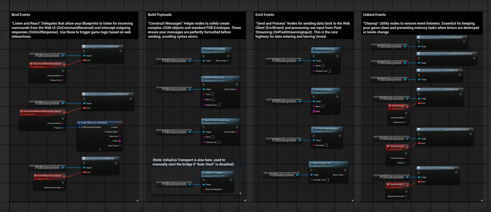
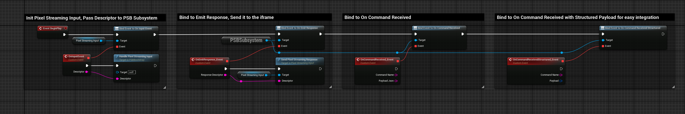
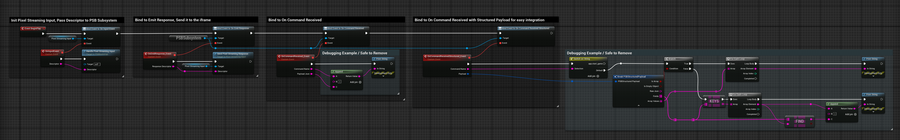
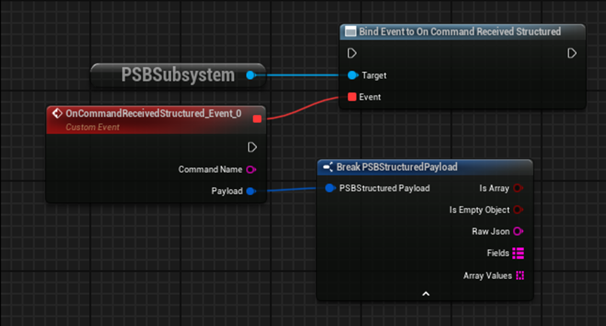
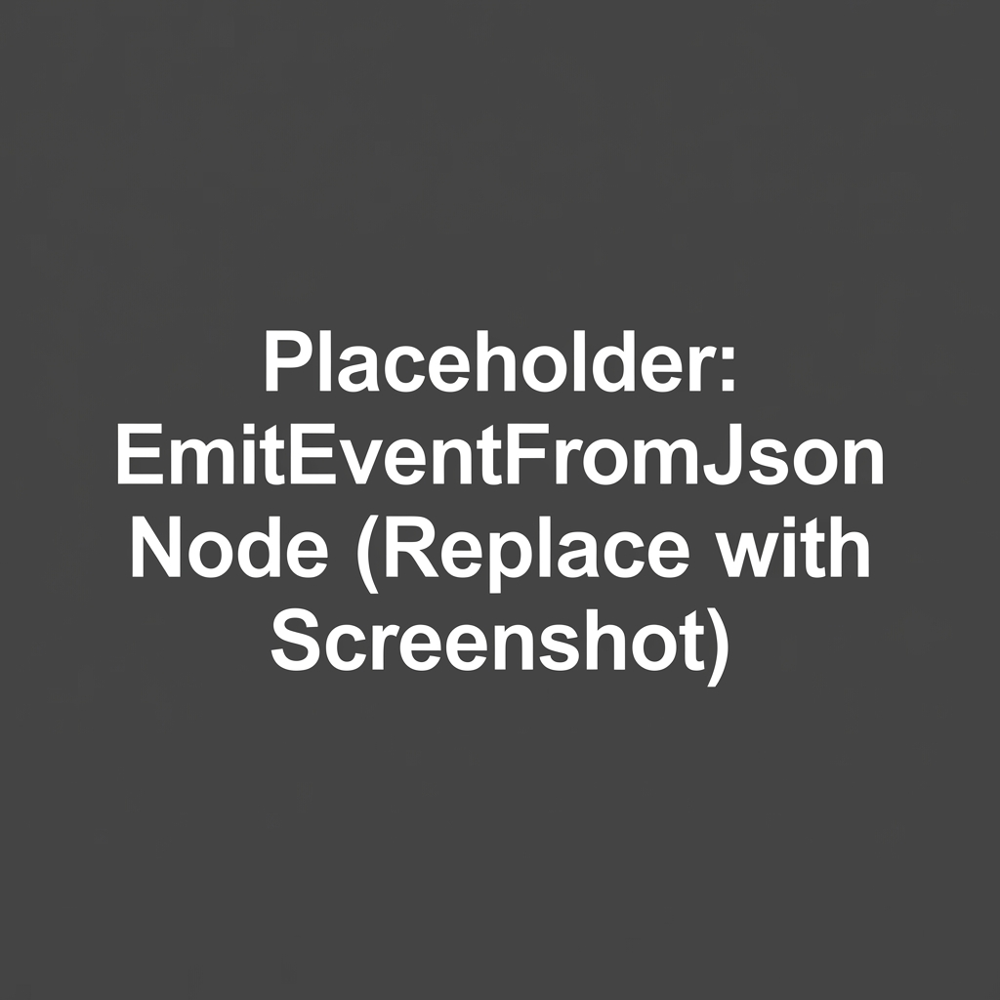
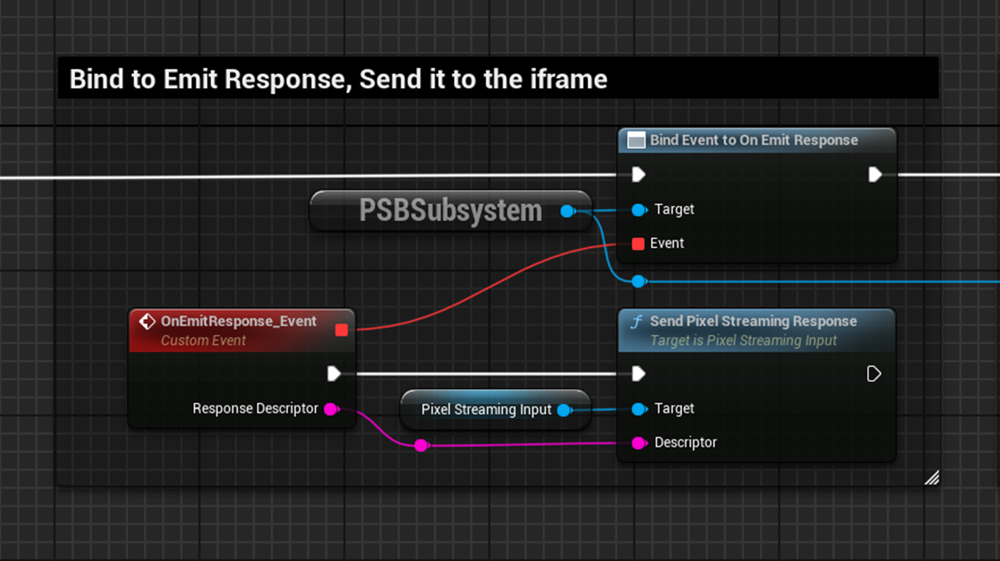
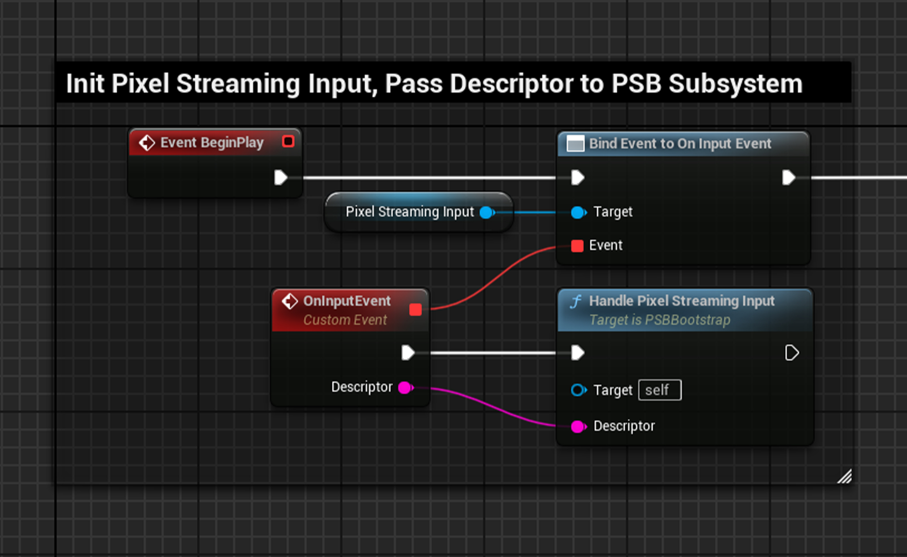

# Pixel Streaming Bridge (PSB) - User Guide

Version 1.1.0.

## Introduction
Pixel Streaming Bridge (PSB) is an Unreal Engine plugin for JSON messaging between an Unreal app streamed with Pixel Streaming and a web page. The page sends **commands** to Unreal; Unreal sends **events** back. Every message uses the same small envelope (see `message-contract.md`):

```json
{ "version": "1.0", "type": "command", "name": "app.set_color", "payload": { "color": "red" } }
```

PSB does not include a signalling server or a web page; it works with Epic's reference signalling server, cloud providers, or your own setup.

## Key Features
- **JSON envelope** for commands (web -> Unreal) and events (Unreal -> web), with optional `requestId` replies.
- **Blueprint and C++**: bind one command with **Bind PSB Command**, or listen to all with **On Command Received**; read fields with typed getters; send with **Emit Event From Json** or **Reply To Command Json**.
- **Message manifest (optional)**: one list of your commands and events with typed fields, used to validate inbound payloads and to generate typings, docs, a DataTable and Blueprint handlers.
- **BP_PSBBootstrap**: drop it in a level to start the bridge.
- **Provider agnostic**: works with any standard Pixel Streaming signalling server.
- **AI assistant tools (optional, editor-only, beta)**: see `AI_ASSISTANT_GUIDE.md`.

## Requirements
- Unreal Engine 5.3, 5.4, 5.5, 5.6, 5.7 or 5.8 (see `COMPATIBILITY.md`), on Windows. The descriptor also allows Linux.
- Epic's **Pixel Streaming** plugin enabled (PSB enables it as a dependency).
- A Pixel Streaming signalling server and a web page for the stream.

## Getting Started

### 1. Installation
1. Install the plugin from Fab (or copy the `PSB` folder into your project's `Plugins` folder).
2. Enable it in **Edit > Plugins** (Pixel Streaming Bridge) and restart the editor.

### 2. Quick start with BP_PSBBootstrap
1. In the Content Browser enable **Show Plugin Content**.
2. Open `Pixel Streaming Bridge (PSB) Content > Blueprints`.
3. Drag **BP_PSBBootstrap** into your level.

BP_PSBBootstrap is a Blueprint of the `PSBBootstrap` actor with a Pixel Streaming Input component. On BeginPlay it:
- starts the PSB transport (setting **Auto Start Transport**), which receives the page's messages in C++ (setting **Bind Input Handlers**);
- binds **On Command Received** and **On Command Received Structured** with example debug graphs;
- sends outgoing events with **Send Pixel Streaming Response** (it implements On Emit Response BP, so it is the one sender).

In Play-In-Editor you need a PSBBootstrap (this one, a Blueprint of your own, or a handler made by the AI tools). To let a packaged or standalone game start the transport without any PSBBootstrap, opt in with **Auto Start Without Bootstrap** (off by default).

### 3. Receiving commands in Blueprint
**One command (recommended, since 1.1.0):**
1. In BeginPlay call **Bind PSB Command** with the command name (for example `app.set_color`) and a Custom Event (drag from the red Delegate pin and choose "Create Event"). The event receives `CommandName` and `Payload`.
2. Read the payload with **Get String Field**, **Get Number Field**, **Get Integer Field**, **Get Bool Field**, **Get String Array**, **Get Number Array**, **Get Object Json** (a nested object as JSON text) and **Has Field**.
3. In EndPlay call **Unbind PSB Command** (or **Unbind All Commands** on the PSB subsystem).

**All commands:** get the **PSB Subsystem** (Game Instance subsystem), bind **On Command Received** (`CommandName`, `PayloadJson`) or **On Command Received Structured** (`CommandName`, `Payload` with flattened string fields), and branch on the command name with Switch on String.

`psb.ping` is answered by PSB itself (`psb.pong`). A command nobody handles is answered with `psb.error` `COMMAND_NOT_FOUND`.

### 4. Sending events
- **Emit Event From Json**: `Name` and a JSON object string, e.g. `app.score_updated`, `{"score": 100}`.
- **Emit Event Simple**: `Name` and a map of string keys and values.
- **Create Payload Builder**: add strings, numbers, booleans, arrays and nested objects, then **Get Json String** for the nodes above.
- **Reply To Command Json** (since 1.1.0): answers a command with an event that carries the command's `requestId`. With an empty event name it uses the response event from the loaded manifest.
- **Build Envelope Json** / **Send Envelope Json**: build and send a full envelope yourself.

**Who sends the envelope.** With nothing bound to **On Emit Response**, the PSB transport sends it to every connected viewer. When a Blueprint binds On Emit Response, that Blueprint sends it (for example with Send Pixel Streaming Response) and the transport does not: this is **Blueprint Owns Responses**, on by default, as in 1.0. Turn it off if your binding should only observe envelopes (logging, analytics) while the transport sends them.

### 5. The web side
With the reference `@psb-ui` packages:

```typescript
import { usePSB } from '@psb-ui/provider';

function MyComponent() {
  const { sendCommand } = usePSB();

  const handleCreate = () => {
    // Sends: { version: "1.0", type: "command", name: "app.spawn_object", payload: { id: "cube" }, requestId: "..." }
    sendCommand('app.spawn_object', { id: 'cube' });
  };

  return <button onClick={handleCreate}>Spawn Cube</button>;
}
```

`sendCommand` returns the `requestId`; an event listener receives `(payload, requestId)`, so you can match a reply sent with Reply To Command Json. Any other web stack works if it sends the same envelope through Pixel Streaming's `emitUIInteraction`.

## The message manifest (optional)
The manifest lists every command and event with its direction, description, typed payload fields and response. Create a **PSB Message Manifest** asset (Content Browser > Miscellaneous > Data Asset > PSB Message Manifest) or a `*.psb.json` file (format in `message-contract.md`), then:
- load it: project setting **Default Manifest** (or **Manifest Json File**), the **Manifest** property of a PSBBootstrap, or **Load Manifest**;
- turn on **Validate Against Manifest** to reject invalid payloads with `psb.error` (code and field) before your handlers run;
- reply with **Reply To Command Json** without repeating event names.

The editor's AI assistant tools can create and maintain the manifest and generate JSON Schemas, TypeScript typings, a commands reference, a DataTable (`FPSBMessageRow`) and a handler Blueprint from it (`AI_ASSISTANT_GUIDE.md`).

## Project settings
Project Settings > Plugins > **Pixel Streaming Bridge**:

| Setting | Default | What it does |
| --- | --- | --- |
| Auto Start Transport | on | PSBBootstrap starts the transport on BeginPlay. |
| Auto Start Without Bootstrap | off | Opt-in: packaged and standalone games also start the transport after a map loads with no PSBBootstrap in the level (needs Auto Start Transport). PSB then takes the `UIInteraction` messages (see Bind Input Handlers). |
| Bind On Command Received / Bind On Emit Response | on | PSBBootstrap binds these events (On Emit Response only when its Blueprint implements On Emit Response BP). |
| Show On Screen Debug | off | Read by PSBBootstrap; the native class prints nothing on screen (use Log Commands or your own Blueprint). |
| Log Commands | on | PSBBootstrap logs received commands. |
| Accept Raw Messages | on | Accept JSON without the envelope and turn it into a command. |
| Bind Input Handlers | on | Receive the page's messages in C++. Pixel Streaming Input components then no longer fire On Input Event for `UIInteraction` messages. |
| Blueprint Owns Responses | on | A bound On Emit Response sends the envelope instead of the transport (1.0 behaviour). Off: it only observes and the transport sends. |
| Traffic History Size | 50 | Envelopes kept for Get Recent Traffic (0 keeps none). |
| Default Manifest / Manifest Json File | empty | The manifest loaded at startup. |
| Validate Against Manifest | off | Check inbound payloads against the manifest. |

The AI assistant server has its own section, **Pixel Streaming Bridge MCP** (editor only).

## C++
- `UPSBSubsystem::RegisterCommand(Name, FPSBCommandDelegate)` registers one C++ handler per command; it runs before the Blueprint handlers.
- `EmitEvent(Name, TSharedPtr<FJsonObject>)` and `ReplyToCommand(RequestId, EventName, Payload)` send events.
- `SetTransport` replaces the transport (the tests use a mock transport); `OnTraffic()` taps every envelope.

## Troubleshooting
- **No video?** Check that the signalling server runs and Unreal connects to it (Output Log, `LogPixelStreaming`).
- **Commands do not arrive?** Check `LogPSB`: is the transport started (a PSBBootstrap in the level for Play-In-Editor)? Is the command name exactly what the page sends? Get Recent Traffic shows what arrived and what became of it.
- **`psb.error` with `INVALID_FIELD_...`?** Validate Against Manifest is on and the payload does not match the manifest.
- **Events arrive twice?** Blueprint Owns Responses was turned off while a Blueprint bound to On Emit Response also sends: turn it back on, or stop sending from that Blueprint.
- **"Waiting for Streamer"?** Check the stream URL in the web client configuration.

---

More: `FAQ.md`, `message-contract.md`, `COMPATIBILITY.md`, `AI_ASSISTANT_GUIDE.md`, `FAB_PRODUCT_DOCS.md`.

## Screenshots

These show nodes available since 1.0; they are unchanged in 1.1.0.



*Figure: the PSB Blueprint nodes (1.0 set).*



*Figure: binding to the PSB subsystem in BP_PSBBootstrap.*



*Figure: BP_PSBBootstrap's example debug graph.*



*Figure: On Command Received Structured.*



*Figure: Emit Event From Json.*



*Figure: On Emit Response. A bound On Emit Response sends the envelopes itself (Blueprint Owns Responses, on by default).*



*Figure: On Pixel Streaming Input, used when Bind Input Handlers is off.*
